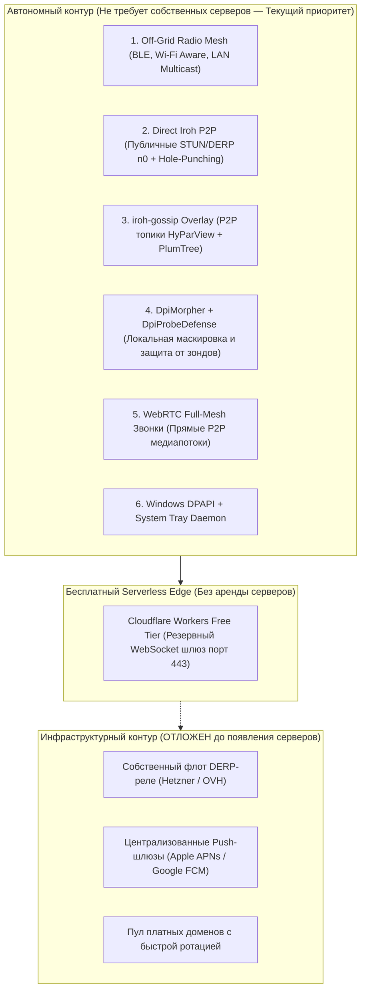

# ADA Messenger — Генеральный план доведения проекта до заявленных функциональных возможностей (Production Target 1.0)

> **Дата составления:** Октябрь 2026  
> **Статус:** Официальный рабочий план реализации (Master Execution Plan) — Редакция 2 (Zero-Infrastructure Strategy)  
> **Основа:** Аудит кодовой базы `ada-core` (Rust), `android-app` (Kotlin/Compose), `desktopApp` (Compose Multiplatform), `cf-workers` (Cloudflare Serverless).

---

## 1. Инвентаризация текущего состояния (Ревизия Октябрь 2026)

| Подсистема | Статус | Реализовано в коде | Заглушка / Требует доработки | Отложено (Серверная инфр.) |
|---|---|---|---|---|
| **P2P Криптография (1:1)** | **100% Готово** | PQXDH (Kyber-768/ML-KEM + X25519), Double Ratchet, заголовочное шифрование, Out-of-Order буфер, 201+ unit/integration тестов. | — | — |
| **Групповые чаты (Scale)** | **85% Готово** | SenderKeys ratcheting, iroh-gossip broadcast/pubsub, подписка на топики, отслеживание присутствия (Presence), доставка сообщений. | Ротация ключей при удалении пира (Epoch rollback protection); восстановление пропущенных пакетов (gap-repair). | — |
| **Звонки (WebRTC 1:1) Android** | **90% Готово** | Сигнализация через TransportRouter, SDP offer/answer, `CallManager.kt`, `WebRTCBridge.kt`, динамический битрейт Opus (32 kbps 1:1, 16 kbps mesh), `CallScreen.kt`. | Аудио-роутинг (Bluetooth SCO / earpiece / speaker). | — |
| **Звонки Desktop (Windows)** | **75% Готово** | UI оверлеи в `DesktopVideoCallOverlay.kt`, интеграция `DesktopWebRtcBridge.kt` с `dev.onvoid.webrtc`, аудио и видео-вызовы разблокированы для групп, VAD и динамический битрейт. | Рендеринг видеопотока в Compose/Skia surface; перечисление аудио-устройств (WASAPI). | — |
| **Групповые звонки (Mesh)** | **70% Готово** | Сигнализация поверх `iroh-gossip` (JoinRequest, Offer, Answer, IceCandidate, Leave) в `api.rs` и `gossip.rs`; динамический Opus-гувернер (масштабирование до 16 kbps на пир при 6 участниках). | UI-сетка участников (2x2 / 3x2) в клиентах. | Выделенные SFU-серверы (не требуются для P2P Mesh до 6 пиров). |
| **Off-Grid Radio Mesh (Ядро)** | **95% Готово** | Компактный фрейм 14 байт (`CompactFrame`), мульти-хоп пересылка (`MeshProcessResult::Forward`), декремент TTL, кэш виденных пакетов (`seen_cache`) для защиты от циклов, рандомизированный джиттер от штормов; персистентное SQLite DTN-хранилище (`dtn_bundles`) со сбросом при обнаружении маяков. | Тонкая калибровка таймаутов TTL под сверхмедленные радиомодемы. | — |
| **Off-Grid Radio (Android)** | **75% Готово** | `LocalMeshManager.kt`: BLE Coded PHY инициализация, L2CAP CoC сокеты, Wi-Fi Aware NAN публикация и подписка, Wi-Fi Direct P2P. | Стабильность в фоне (`ForegroundService` с типом `connectedDevice`); переключение на NAN Datapath при передаче файлов > 50 КБ. | — |
| **Off-Grid Radio (Desktop)** | **40% Начато** | `DesktopP2pRadioEngine.kt`: широковещательный LAN Multicast (UDP `239.255.42.99:45824`), маяки. | Интеграция с Windows Native BLE (`Windows.Devices.Bluetooth.Advertisement`) через JNI/JNA. | — |
| **Антицензура и Маскировка (Local/P2P)** | **95% Готово** | `DpiMorpher` (TLS 1.3 Record framing `0x17 0x03 0x03`, дискретное квантование корзин длин 512..4096, HKDF-SHA256 маскирование потока); `DpiCensorEmulator` с математическим анализом энтропии Шеннона ($H > 7.5$) и проверкой сигнатур; `DpiProbeDefense` с отдачей HTML 200/404 и TLS Alert при активном зондировании. | JA3/JA4 отпечатки в TLS ClientHello. | — |
| **Серверные Мосты и Реле** | **30% (Standby)** | Код воркера `cf-workers/serverless-bridge-worker` готов; клиентские fallbacks в `TransportRouter` реализованы. | — | Выделенный серверный кластер VPS (Hetzner/OVH); платный пул Cloudflare Enterprise с кастомными доменами. |
| **Безопасность Windows** | **60% Готово** | ADPV PIN vault, 5-цветный графический паттерн, десктопная изоляция БД. | `protocol_device_anchor.bin` пишется в `%APPDATA%` в открытом виде (без DPAPI). | Аппаратная привязка через Windows DPAPI (`CryptProtectData`). |
| **Десктопный UX** | **65% Готово** | Compose Multiplatform интерфейс, список чатов, профили, поиск пиров, NSIS инсталлятор. | Сворачивание в системный трей; нативные WinRT Toast-уведомления; Drag-and-drop файлов. | — |

---

## 2. Стратегия реализации в условиях отсутствия собственной сетевой инфраструктуры

> **Ключевой фактор:** На текущем этапе проект **не располагает собственной серверной инфраструктурой** (нет арендованных VPS, нет выделенных серверов реле, нет платных доменов и постоянных серверов очередей).
>
> **Архитектурный принцип ADA Messenger:** Полная независимость от центральных серверов (Zero-Infrastructure First). Мессенджер строится на принципах **локального P2P, радио-меша и бесплатного serverless edge**.

---

## 3. Оставшиеся шаги реализации (Порядок действий)

Учитывая ограничение по инфраструктуре, все работы сфокусированы на **Автономном контуре (Zero-Infrastructure)** и доведении клиентских приложений до совершенства.

---

### Шаг 1. Windows Desktop: Аппаратная защита ключей через DPAPI (Безопасность)
* **Зачем:** На Windows файл `protocol_device_anchor.bin` лежит в `%APPDATA%/ADAMessenger/` без шифрования ключом ОС. При физическом доступе или дампе диска злоумышленник может скопировать анкер.
* **Что делаем (Zero-infra):**
  1. В `DesktopPlatformSupport.kt` внедрить вызов Win32 API `CryptProtectData` и `CryptUnprotectData` (через JNA/JNI) с флагом `CRYPTPROTECT_UI_FORBIDDEN`.
  2. Шифровать анкер мастер-ключом профиля пользователя Windows.
  3. Обеспечить корректную миграцию существующего незашифрованного анкера при первом запуске новой версии.
* **Файлы:** [DesktopPlatformSupport.kt](file:///d:/QUADA/android-app/desktopApp/src/desktopMain/kotlin/com/ada/messenger/desktop/core/DesktopPlatformSupport.kt), [DesktopIdentityStore.kt](file:///d:/QUADA/android-app/desktopApp/src/desktopMain/kotlin/com/ada/messenger/desktop/core/DesktopIdentityStore.kt).

---

### Шаг 2. Windows Desktop: Системный трей и нативные фоновые уведомления
* **Зачем:** Десктопное приложение для координаторов и журналистов должно висеть в фоне при закрытии крестиком `[X]` и присылать системные уведомления.
* **Что делаем (Zero-infra):**
  1. **System Tray Daemon:** интеграция `java.awt.SystemTray` / нативного трея Compose. Сворачивание в трей при клике на `[X]`, контекстное меню (Открыть, Статус сети, Выход).
  2. **Иконка статуса:** Зеленый (P2P онлайн), Желтый (подключение/восстановление), Синий (через мост), Серый (офлайн/радио).
  3. **WinRT Toast Notifications:** локальные всплывающие уведомления Windows 10/11 с конфиденциальным режимом (скрывать текст сообщения при заблокированном экране).
  4. **Drag-and-Drop:** поддержка перетаскивания файлов прямо в окно активного чата.
* **Файлы:** [Main.kt](file:///d:/QUADA/android-app/desktopApp/src/desktopMain/kotlin/com/ada/messenger/desktop/Main.kt), [DesktopWorkspaceScreen.kt](file:///d:/QUADA/android-app/desktopApp/src/commonMain/kotlin/com/ada/messenger/desktop/ui/screens/DesktopWorkspaceScreen.kt).

---

### Шаг 3. Стабилизация мобильных радио-драйверов Android (Doze Mode & Foreground Service)
* **Зачем:** Android 14+ агрессивно «усыпляет» радио-стек BLE и Wi-Fi при выключенном экране.
* **Что делаем (Zero-infra):**
  1. Завершить оформление выделенного сервиса `MeshRadioForegroundService` с `WAKE_LOCK` и атрибутом `android:foregroundServiceType="connectedDevice"`.
  2. Батарейный гувернер: динамическая смена частоты сканирования BLE (при заряде > 50% — `SCAN_MODE_LOW_LATENCY`, при < 30% — `SCAN_MODE_LOW_POWER`).
  3. Автоматический переход на Wi-Fi Aware NAN Datapath при передаче вложений > 50 КБ без разрыва BLE-сессии.
* **Файлы:** [LocalMeshManager.kt](file:///d:/QUADA/android-app/app/src/main/java/com/ada/messenger/core/LocalMeshManager.kt), [AndroidManifest.xml](file:///d:/QUADA/android-app/app/src/main/AndroidManifest.xml).

---

### Шаг 4. Масштабирование группового криптографического храповика (SenderKeys)
* **Зачем:** При исключении скомпрометированного участника из группы он не должен иметь возможности читать последующие сообщения, даже оставаясь в том же gossip-топике.
* **Что делаем (Zero-infra):**
  1. **Epoch Rollback Protection:** при удалении участника администратор инициирует новую эпоху (Epoch ID + 1). Генерируется новая цепочка ключей группы, которая персонально передается оставшимся участникам через 1:1 Double Ratchet.
  2. **Gap-Repair Gossip:** если узел получает порядковый номер сообщения $N+2$ в отсутствие $N+1$, он рассылает легковесный P2P-запрос соседям по дереву топика для докачки пропущенного фрагмента.
* **Файлы:** [ada-core/src/group/sender_keys.rs](file:///d:/QUADA/ada-core/src/group/), [ada-core/src/network/gossip.rs](file:///d:/QUADA/ada-core/src/network/gossip.rs).

---

### Шаг 5. Непрерывный фаззинг и документация для аудита
* **Зачем:** Подтверждение максимальной надежности парсеров бинарных структур в неблагоприятных сетях перед независимым аудитом.
* **Что делаем (Zero-infra):**
  1. Написание фаззинг-таргетов `cargo-fuzz` (libFuzzer):
     - `fuzz_compact_frame`: декодирование 14-байтных радиокадров с искаженными TTL, CRC и флагами.
     - `fuzz_dpi_morpher`: устойчивость распаковки TLS 1.3 фреймов при намеренной порче соли и байтов гаммы.
     - `fuzz_gossip_envelope`: проверка устойчивости к невалидным подписям и битым полям.
  2. Прогон не менее 100 000 000 итераций без сбоев памяти и паник.
  3. Формирование спецификации криптографических протоколов (Formal Cryptographic Specification).
* **Файлы:** `ada-core/fuzz/`, `docs/audits/`.

---

### Шаг 6. (Отложено) Инфраструктурный этап: Собственные серверы и платный флот
* **Условие старта:** Появление выделенного бюджета и серверных мощностей.
* **Состав задач:**
  1. Аренда пула VPS в юрисдикциях с нейтральным сетевым регулированием (Швейцария, Исландия, Нидерланды).
  2. Сборка и деплой бинарника `ada-bridge-node` в качестве приватного высокоскоростного DERP-реле.
  3. Платный тариф Cloudflare Workers / Enterprise с кастомными доверенными доменами и распределенным хранилищем Durable Objects.
  4. Настройка гео-DNS и ротации адресов при блокировках IP-диапазонов.

---

## 4. Сводная шкала готовности к релизу (Definition of Done 1.0)

| Критерий | Состояние | Верификация |
|---|:---:|---|
| **Off-Grid Radio Mesh Multi-Hop** | **Готово** | `test_multihop_forwarding_and_ttl`, `test_dtn_queue_drain` (SQLite персистентность) — тесты пройдены. |
| **Gossip Group Signaling & Presence** | **Готово** | Сигнализация звонков Offer/Answer/Candidate/Leave и Presence-события подключены в ядре. |
| **DpiMorpher & Active Probe Defense** | **Готово** | `test_dpi_censor_emulator_passes_dpi_morpher`, `test_dpi_probe_defense_http_decoy` — тесты пройдены. |
| **Адаптивный Opus WebRTC битрейт** | **Готово** | Динамическое масштабирование битрейта (32 → 16 kbps) в Android и Desktop WebRTC. |
| **Windows DPAPI Security** | *В плане (Шаг 1)* | Шифрование `protocol_device_anchor.bin` через Win32 `CryptProtectData`. |
| **Windows Tray & Notifications** | *В плане (Шаг 2)* | Фоновый демон, иконка в трее со статусом, WinRT Toast. |
| **Android Foreground Radio Service** | *В плане (Шаг 3)* | Автономная работа радио-модемов при выключенном экране. |
| **Group Epoch Key Rotation** | *В плане (Шаг 4)* | Ротация эпохи SenderKeys при удалении участника. |
| **Тестовое покрытие ядра** | **201 тест пройден (0 сбоев)** | Полный прогон `cargo test --features mobile-dev --lib` успешен. |
