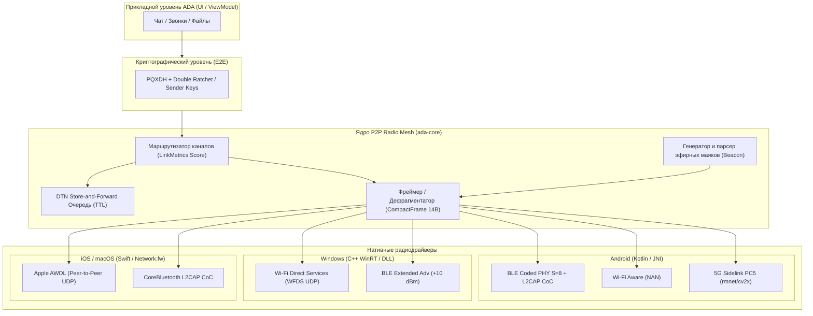

# План интеграции автономного многоканального радио-меш стека (Off-Grid Radio Mesh) в ADA Messenger

> **Статус документа:** Проект плана (ожидает утверждения пользователем)  
> **Основа:** Экспериментальные наработки из `E:\Эксперименты для Ады` (`p2p-radio-core`)  
> **Целевые платформы:** Android (Kotlin / NDK), Windows Desktop (Compose Multiplatform / C++ WinRT), ядро Rust (`ada-core`), задел под iOS (Swift / AWDL)  
> **Дата составления:** 20 октября 2026 г.  

---

## 1. Концепция и цели интеграции

Текущая реализация локального транспорта в ADA Messenger (`TransportRoute::LocalMesh`) базируется на стандартном BLE GATT и Wi-Fi Direct. Данный подход имеет существенные физические и архитектурные ограничения:
- **Ограниченный радиус BLE:** Обычный BLE 4.2 GATT обеспечивает дальность не более 20–40 метров.
- **Оверхед протокола GATT:** Передача через ATT-характеристики требует пошагового подтверждения каждого чанка на уровне стека Bluetooth ОС, что приводит к низкому битрейту и частым разрывам сессий.
- **Конфликт Wi-Fi Direct:** `WifiP2pManager` при создании P2P-группы отключает смартфон от рабочей Wi-Fi сети (или блокируется при активной мобильной точке доступа), а также требует системных диалогов согласования.
- **Изоляция Windows Desktop:** Десктопная версия ADA для Windows полностью лишена оффлайн-транспорта и не способна взаимодействовать с находящимися рядом смартфонами без интернет-инфраструктуры.

### Цели интеграции экспериментального стека:
1. **Увеличение дальности связи в 10–20 раз:** Переход на **BLE Coded PHY (Bluetooth 5.0+ Long Range S=8)** с усилением чувствительности +12 dB увеличивает радиус радиосвязи «из кармана в карман» **до 500–800 метров** на открытой местности.
2. **Отказ от GATT в пользу L2CAP CoC:** Использование сырых сокетов **L2CAP Connection-Oriented Channels (CoC)** без спаривания ОС (Insecure L2CAP) устраняет GATT-оверхед и увеличивает пропускную способность.
3. **Бесшовный Wi-Fi Aware (NAN):** Использование **Neighbor Awareness Networking** на частотах 2.4 / 5 ГГц обеспечивает скорость **25+ Мбит/с** без создания виртуальной точки доступа, без ввода паролей и **без разрыва существующего Wi-Fi подключения**.
4. **Оффлайн-меш для Windows Desktop:** Реализация драйвера на C++/WinRT (`WiFiDirectServiceAdvertiser` + Extended BLE) для прямого обмена сообщениями между ПК и смартфонами без роутеров.
5. **Компактный канальный фрейм (`CompactFrame` 14B):** Внедрение ультракомпактного протокола с 4-байтными идентификаторами Blake3, пофрагментной передачей и подтверждениями (ACK), экономящего узкий эфирный битрейт.
6. **DTN (Delay-Tolerant Networking) с эфирными маяками (Beacons):** Автоматическая доставка сообщений «при встрече» (Store-and-Forward) с контролем времени жизни (TTL).
7. **Поддержка 5G Sidelink (3GPP Rel-16/17 PC5):** Задел под сверхдальнобойную прямую радиосвязь (до 1.5 км) через модемные интерфейсы C-V2X/ProSe.

---

## 2. Архитектура и уровни стека

---

## 3. Детализация ключевых протоколов

### 3.1. Структура компактного фрейма (`CompactFrame`)
Заголовок занимает ровно **14 байт**, что позволяет упаковать даже отдельный фрагмент в один минимальный BLE MTU пакет:

| Байт | Поле | Описание |
|---|---|---|
| `[0]` | `ver_type` | `version` (старшие 4 бита) + `frame_type` (младшие 4 бита) |
| `[1..4]` | `sender_short_id` | Первые 4 байта `Blake3(Ed25519_PubKey)` отправителя |
| `[5..8]` | `recipient_short_id` | Первые 4 байта `Blake3(Ed25519_PubKey)` получателя (`0xFFFFFFFF` = Broadcast) |
| `[9..10]` | `msg_id` | Уникальный счетчик сообщения `u16` |
| `[11]` | `frag_index` | Индекс фрагмента (`0..frag_total-1`) |
| `[12]` | `frag_total` | Общее количество фрагментов в сообщении |
| `[13]` | `ttl` | Ограничение пересылок / Hop Limit |
| `[14..]` | `payload` | Зашифрованная полезная нагрузка (или 32 байта PubKey для Beacon) |

**Типы фреймов (`FrameType`):**
- `0x01` — `Beacon`: Эфирный маяк обнаружения (содержит полный 32-байтный Ed25519 PubKey).
- `0x02` — `Handshake`: Инициализация криптографического контекста.
- `0x03` — `DataConfirm`: Пакет данных, требующий обязательного подтверждения `Ack`.
- `0x04` — `DataNonConf`: Потоковые данные без подтверждения (фрагменты голоса, телеметрия).
- `0x05` — `Ack`: Квитанция подтверждения доставки сообщения `msg_id`.

### 3.2. Алгоритм скоринга радиоканалов (`score_for_payload`)
При отправке ядро оценивает каждый активный маршрут пира:
$$\text{Score} = (\text{RSSI}_{\text{dBm}} + 110) \times 10 - \frac{\text{PayloadLen} \times 8}{\text{Bandwidth}_{\text{kbps}}} - \frac{\text{RTT}_{\text{ms}}}{2}$$
- **Короткие сообщения (текст, ACK):** Выбирается **BLE Coded PHY (S=8)** благодаря минимальному энергопотреблению и огромной дальности (до 800 м).
- **Большие сообщения (вложения, аудиосообщения, файлы):** Выбирается **Wi-Fi Aware (NAN)** или **WFDS** (полоса 25+ Мбит/с, MTU 1450).

---

## 4. Пошаговый план внедрения

### Фаза 1. Ядро Rust (`ada-core`): Компактный фрейминг, роутинг и DTN
1. **Создание модуля `ada-core/src/network/mesh_radio.rs`:**
   - Перенос структур `CompactFrame`, `FrameType`, `LinkMetrics`, `ActiveRoute`, `DtnBundle`.
   - Реализация трейта `TransportDriver` и базового диспетчера `P2pMessengerCore`.
   - Алгоритм фрагментации `fragment_payload` и потоковой дефрагментации `FragmentBuffer` с таймаутом очистки устаревших чанков.
2. **Интеграция с существующей криптографией ADA:**
   - Реализация адаптера шифрования поверх существующего Double Ratchet / PQXDH (`CryptoSessionProvider`).
   - Автоматическое вычисление 4-байтных `short_id` из `PeerId` (Blake3).
3. **DTN Store-and-Forward очередь:**
   - Локальное сохранение недоставленных сообщений в RocksDB / KV-хранилище с настраиваемым TTL (по умолчанию 24 часа).
   - Автоматический флаш очереди `flush_dtn_for_peer` при получении валидного фрейма `Beacon`.
4. **Расширение FFI / JNI API:**
   - `ada_mesh_on_incoming_frame(transport_id, hw_addr, rssi, data, len)`
   - Экспорт функций регистрации радиодрайверов и коллбэков отправки в сторону ОС.
5. **Unit-тесты:**
   - Тестирование упаковки, распаковки, фрагментации и переупорядочивания пакетов.

---

### Фаза 2. Android: BLE Coded PHY (S=8 Long Range) + L2CAP CoC
1. **Проверка возможностей радиочипа:**
   - Проверка `bluetoothAdapter.isLeCodedPhySupported` (на современных чипсетах Qualcomm, Exynos, Tensor).
   - Динамический выбор: `PHY_LE_CODED` при поддержке, прозрачный фолбэк на 1M PHY на бюджетных чипах.
2. **Сервер L2CAP CoC (Connection-Oriented Channels):**
   - Открытие небезопасного канала `listenUsingInsecureL2capChannel()` (E2E шифрование обеспечивает `ada-core`).
   - Получение динамического порта `allocatedPsm`.
3. **Extended Advertising:**
   - Инициализация `AdvertisingSetParameters` с `setLegacyMode(false)`, `setPrimaryPhy(BluetoothDevice.PHY_LE_CODED)`, `setSecondaryPhy(BluetoothDevice.PHY_LE_CODED)`.
   - Упаковка 2 байт PSM в `AdvertiseData` сервиса `SERVICE_UUID`.
4. **Клиент L2CAP CoC:**
   - Сканирование в режиме `PHY_LE_CODED`.
   - При обнаружении пира: `device.connectGatt(..., PHY_LE_CODED_MASK, PHY_OPTION_S8)`.
   - Подключение сокета `device.createInsecureL2capChannel(psm)` и потоковое чтение в `ada_mesh_on_incoming_frame`.
5. **Сохранение обратной совместимости:**
   - Сохранение существующего GATT-сервера как вторичного канала для устройств без поддержки L2CAP CoC.

---

### Фаза 3. Android: Wi-Fi Aware (NAN) — Высокоскоростной P2P канал
1. **Инициализация `WifiAwareManager`:**
   - Проверка `wifiAwareManager.isAvailable` (Android 8.0+ / API 26+).
   - Подключение `WifiAwareSession` через `manager.attach(...)`.
2. **Фоновый Discovery:**
   - `PublishConfig` с сервисом `"ada_mesh_nan_v1"`.
   - `SubscribeConfig` для поиска пиров вокруг без разрыва подключения к домашнему/офисному Wi-Fi.
3. **Мгновенный обмен короткими пакетами (Discovery Session Messages):**
   - Передача фреймов размером до 255 байт через `session.sendMessage(peerHandle, msgId, bytes)` без создания сокета.
4. **Установка прямого высокоскоростного Data-Path (Android 10+ / API 29+):**
   - Запрос сетевого профиля `NetworkCapabilities.NET_CAPABILITY_WIFI_AWARE`.
   - Открытие прямого двунаправленного сокета (MTU ~1450, 25+ Мбит/с) для передачи файлов, медиа и резервного аудио.

---

### Фаза 4. Windows Desktop: WinRT P2P Radio Engine
1. **Модуль `ada-winrt-radio` (C++20 / C++/WinRT):**
   - Сборка нативной динамической библиотеки или интеграция через JNI в `desktopApp`.
2. **Wi-Fi Direct Services (WFDS):**
   - Использование `WiFiDirectServiceAdvertiser(L"org.ada.messenger.nan")` с `AutoAcceptSession(true)`.
   - Прием входящих подключений и открытие `DatagramSocket` (UDP) между ПК и смартфонами.
3. **Bluetooth 5 Extended Advertising на Windows:**
   - Использование `BluetoothLEAdvertisementPublisher` с `UseExtendedAdvertisement(true)` и мощностью `+10 dBm`.
   - Прием пакетов через `BluetoothLEAdvertisementWatcher` (`AllowExtendedAdvertisements = true`).
4. **Связка с UI десктопа:**
   - Индикация обнаруженных локальных радио-пиров в статус-баре десктопного приложения.

---

### Фаза 5. Экспериментальный драйвер 5G Sidelink (3GPP Rel-16/17 PC5)
1. **Мониторинг модемного HAL:**
   - Периодический опрос сетевых интерфейсов ядра Linux/Android: `rmnet_data_pc5`, `cv2x0`, `prose0`, `sl0`.
2. **IPv6 Link-Local UDP сокет:**
   - При обнаружении интерфейса: привязка UDP-сокета к мультикаст-группе `[ff02::1]:5500` или стандартизированному адресу `239.255.70.77:5500`.
3. **Интеграция в диспетчер транспортов:**
   - Регистрация как `TransportKind::CellularSidelink` с максимальным приоритетом дальности (до 1.5 км).

---

### Фаза 6. Валидация, полевые тесты и безопасность
1. **Автоматизированные тесты ядра:**
   - Полный прогон симуляции многоканального меша (переключение каналов на лету при падении RSSI, восстановление после разрыва).
2. **Полевые тесты дальности:**
   - Замер дальности связи в городских условиях и на открытой местности:
     - Обычный BLE GATT: ~30 м (базовая линия).
     - BLE Coded PHY (S=8): целевой показатель 300–600 м в городской застройке, до 800 м в поле.
     - Wi-Fi Aware: до 150–200 м на открытом воздухе со скоростью 10–25 Мбит/с.
3. **Тестирование энергопотребления и фона:**
   - Проверка работы в Android Doze Mode и фоновом режиме с оптимизированными интервалами маяков (Beacons раз в 10–30 секунд в покое, раз в 2 секунды при активном поиске).
4. **Аудит безопасности радиоканала:**
   - Исключение утечек реального Ed25519 публичного ключа при сканировании (в открытом эфире транслируются только эфемерные или усеченные хэши, полное рукопожатие защищено PQXDH).

---

## 5. Матрица рисков и стратегии смягчения

| Риск | Влияние | Стратегия смягчения |
|---|---|---|
| **Отсутствие поддержки Coded PHY на части старых устройств** | Устройство не может работать на дистанциях 500+ м | Автоматический runtime-детект: если `isLeCodedPhySupported == false`, прозрачно используется стандартный BLE 1M PHY. |
| **Ограничения прав Android 12+ / 13+** | Невозможность запуска сканирования без разрешений | Запрос разрешений `BLUETOOTH_SCAN`, `BLUETOOTH_ADVERTISE`, `NEARBY_WIFI_DEVICES` с понятным UI-онбордингом в настройках меша. |
| **Фоновые ограничения фоновой службы Android** | ОС усыпляет Bluetooth/Wi-Fi сканирование через 10–15 минут | Использование существующего Foreground Service ADA с типом `connectedDevice` и адаптивными интервалами опроса. |
| **Блокировка 5G Sidelink операторской прошивкой** | PC5 интерфейс отсутствует в системе | Драйвер PC5 работает исключительно в пассивном plug-and-play режиме: активируется только при реальном обнаружении интерфейса, не влияя на стабильность системы при его отсутствии. |

---

## 6. Чеклист готовности к реализации

- [ ] **Шаг 1:** Согласование архитектурного плана с пользователем.
- [ ] **Шаг 2:** Создание модуля `ada-core/src/network/mesh_radio.rs` с фреймингом `CompactFrame` и unit-тестами.
- [ ] **Шаг 3:** Интеграция DTN Store-and-Forward в `ada-core` с поддержкой эфирных маяков.
- [ ] **Шаг 4:** Реализация BLE Coded PHY (S=8) + L2CAP CoC в Android `LocalMeshManager.kt`.
- [ ] **Шаг 5:** Реализация Wi-Fi Aware (NAN) в Android `LocalMeshManager.kt`.
- [ ] **Шаг 6:** Разработка Windows C++/WinRT модуля для десктопного меша.
- [ ] **Шаг 7:** Прогон регрессионных тестов `cargo test` и Android `testDebugUnitTest`.

---

*Документ подготовлен для предварительного ознакомления. Реализация не начинается до явного подтверждения пользователя.*
